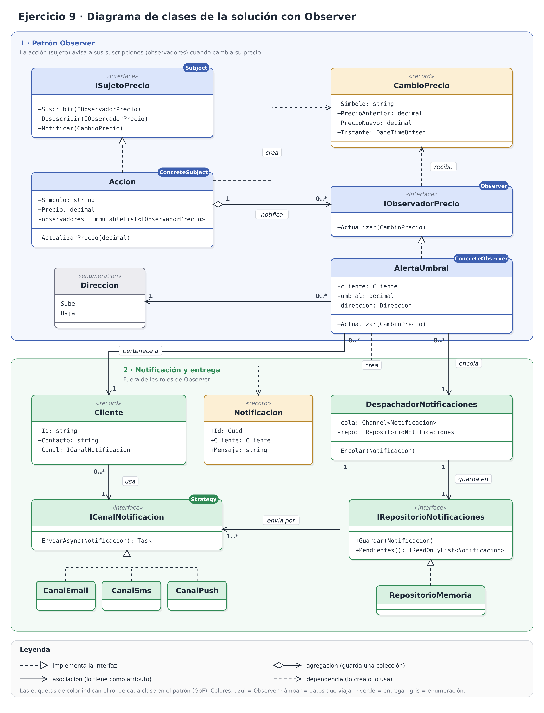

# Cómo leer el diagrama de clases del inciso a

El diagrama se lee de arriba abajo, siguiendo lo que pasa cuando cambia el precio de una acción. Tiene dos zonas:

- **Zona 1 · Patrón Observer** (fondo azul): las clases que cumplen los roles del patrón.
- **Zona 2 · Notificación y entrega** (fondo verde): clases de apoyo que no son parte de Observer y que deciden quién recibe el aviso y cómo se envía.

Cada clase lleva una etiqueta de color en la esquina con su rol en el patrón (GoF).

## 1. El patrón Observer (zona 1)

- **`ISujetoPrecio`** (`Subject`): interfaz con `Suscribir`, `Desuscribir` y `Notificar`.
- **`Accion`** (`ConcreteSubject`): implementa `ISujetoPrecio` (flecha punteada con triángulo). Guarda el símbolo, el precio y la lista de observadores.
- **`Accion` ◇→ `IObservadorPrecio`**, con multiplicidad **1 → 0..\***: una acción tiene de cero a muchos observadores. El rombo vacío indica agregación: la acción guarda a los observadores en su lista, pero no los crea ni los destruye.
- **`IObservadorPrecio`** (`Observer`): interfaz con un único método, `Actualizar(CambioPrecio)`.
- **`AlertaUmbral`** (`ConcreteObserver`): implementa `IObservadorPrecio`. Cada objeto es **una suscripción**: un cliente, un umbral y una dirección. Por eso el umbral vive aquí y no en la acción.
- **`Direccion`**: enumeración con los valores `Sube` y `Baja`. Indica si la alerta salta cuando el precio sube por encima del umbral o cuando baja por debajo. Cada alerta tiene exactamente una (0..\* → 1).

### El mensaje que viaja

- **`CambioPrecio`** (en ámbar) lo **crea** la `Accion` y lo **recibe** el observador. Las flechas punteadas son dependencias: uso temporal, no un atributo.
- Lleva el precio anterior y el nuevo. Eso es el **modelo push**: el observador recibe todo lo que necesita para saber si se cruzó el umbral, sin tener que volver a consultar a la acción.

## 2. Notificación y entrega (zona 2)

`AlertaUmbral` es el puente entre las dos zonas. Desde ella salen tres flechas hacia abajo:

- **pertenece a `Cliente`** (0..\* → 1): un cliente puede tener muchas alertas, sobre una o varias acciones.
- **crea `Notificacion`** (en ámbar, porque también es un dato que viaja) cuando el precio cruza su umbral.
- **encola** esa notificación en el **`DespachadorNotificaciones`** (0..\* → 1).

A partir de ahí:

- **`Cliente` usa un `ICanalNotificacion`**: cada cliente elige su canal.
- **`CanalEmail`, `CanalSms` y `CanalPush`** implementan esa interfaz y comparten un único triángulo de herencia. Funciona como un **Strategy** (por eso lleva esa etiqueta): el observador decide **si** hay que avisar y el canal decide **cómo** se entrega el aviso.
- **`DespachadorNotificaciones`** separa la detección del evento del envío real:
  - **envía por** los canales (1 → 1..\*);
  - **guarda en** el **`IRepositorioNotificaciones`** (1 → 1), que **`RepositorioMemoria`** implementa en memoria para el inciso b.

  El inciso c usará el despachador para el envío asíncrono, y la restricción lo usará para la persistencia y los reintentos.

## Leyenda de flechas

| Flecha | Significado | Ejemplo en el diagrama |
|---|---|---|
| Punteada con triángulo vacío | implementa una interfaz | `Accion` → `ISujetoPrecio` |
| Rombo vacío y línea continua | agregación (guarda una colección) | `Accion` → `IObservadorPrecio` |
| Línea continua con flecha abierta | asociación (lo tiene como atributo) | `AlertaUmbral` → `Cliente` |
| Punteada con flecha abierta | dependencia (lo crea o lo usa de paso) | `Accion` → `CambioPrecio` |

## Colores

| Color | Qué agrupa |
|---|---|
| Azul | clases con un rol en el patrón Observer |
| Ámbar | datos que viajan (`CambioPrecio`, `Notificacion`) |
| Verde | entrega de la notificación |
| Gris | enumeración |

## En resumen

1. La `Accion` cambia de precio y crea un `CambioPrecio`.
2. Avisa a todas sus `AlertaUmbral` con `Actualizar(CambioPrecio)`.
3. Cada alerta comprueba si el precio **cruzó** su umbral en su dirección.
4. Si lo cruzó, crea una `Notificacion` y la encola en el despachador.
5. El despachador la envía por el canal del cliente (email, SMS o push) y la guarda en el repositorio.
