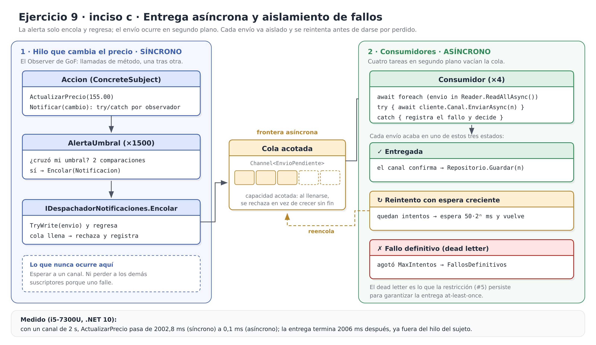

# Ejercicio 9, inciso c): Análisis

**Issue:** #3

> *¿Qué pasa si un cliente no puede ser notificado? ¿Cómo evitar bloquear el hilo principal? ¿Observer es síncrono o asíncrono?*

Las tres preguntas se responden sobre el código del [inciso b](inciso-b.md). Nada de lo que se afirma aquí se queda en la teoría: cada punto tiene su demostración ejecutable y su prueba unitaria.

```sh
cd codigo
dotnet run --project Bolsa.Notificaciones -- asincrono   # la demostración de este inciso
dotnet test                                              # 20 pruebas, 9 de ellas de este inciso
```

## Las respuestas en corto

| Pregunta | Respuesta |
|---|---|
| ¿Qué pasa si un cliente no puede ser notificado? | En el Observer clásico, **la excepción corta el bucle de notificación** y los suscriptores que vienen detrás se quedan sin aviso. Se arregla con dos cosas distintas: aislar a cada observador (para no perder a los demás) y una cola con reintentos (para no perder al que falló). |
| ¿Cómo evitar bloquear el hilo principal? | Separando *detectar* el cruce de *enviar* el aviso: la alerta solo encola y el envío lo hacen consumidores en segundo plano. Medido: el cambio de precio pasa de **2002,8 ms a 0,1 ms** con un canal de 2 s. |
| ¿Observer es síncrono o asíncrono? | **Síncrono por defecto.** `Notificar` llama a `Actualizar` como una llamada de método normal, en el hilo de quien cambió el estado. Puede hacerse asíncrono, pero el patrón no lo es: lo asíncrono es lo que el observador hace con el aviso. |

---

## 1. ¿Qué pasa si un cliente no puede ser notificado?

### 1.1 El problema: el fallo de un cliente deja sin aviso a los demás

El Observer de GoF recorre la lista de observadores y llama a `Update` sin ninguna protección:

```cpp
void Subject::Notify () {
    ListIterator<Observer*> i(_observers);
    for (i.First(); !i.IsDone(); i.Next()) {
        i.CurrentItem()->Update(this);
    }
}
```
*(Gamma et al., 1994, p. 335)*

El `Notificar` del inciso b era exactamente eso. Si un cliente no se puede notificar —un correo que ya no existe, un teléfono dado de baja, la pasarela de SMS caída—, la excepción recorre toda la cadena hacia arriba:

```
CanalSms.EnviarAsync  →  lanza
  DespachadorNotificaciones.Encolar   (entrega síncrona: GetAwaiter().GetResult() la relanza)
    AlertaUmbral.Actualizar
      Accion.Notificar                 ← el foreach se interrumpe aquí
        Accion.ActualizarPrecio        ← y la excepción sale incluso del cambio de precio
```

Las consecuencias concretas en este problema son graves:

- **Un solo cliente silencia a una multitud.** Las alertas se recorren en el orden en que se suscribieron, así que un número de teléfono dado de baja deja sin aviso a todos los que se suscribieron después de él. En la simulación del inciso b, el tick 10 reparte **231 avisos**: si el segundo falla, los otros 229 no salen.
- **El sujeto queda a medias.** La excepción sale de `ActualizarPrecio`, de modo que un problema de *entrega* acaba rompiendo la *cotización*. Son dos responsabilidades que no deberían compartir destino.
- **El fallo es silencioso para quien importa.** Nadie registra que ese cliente no recibió su aviso, y la notificación se pierde sin dejar rastro.

Es el riesgo que GoF ya señala en las consecuencias del patrón: como los observadores no se conocen entre sí, «una operación aparentemente inocua sobre el sujeto puede provocar una cascada de actualizaciones» cuyo costo el sujeto no controla (Gamma et al., 1994, p. 330). Aquí la cascada no solo es costosa: es frágil.

**Demostración** (`AccionSinAislamiento`, el Subject clásico, con tres alertas y un canal caído en el medio):

```text
――― 1a. Observer clásico: un fallo corta el bucle ―――
[EMAIL → cliente0001@correo.cu] AAPL subió por encima de su umbral 151.00: 150.00 → 155.00
  ActualizarPrecio lanzó InvalidOperationException: El proveedor rechazó el aviso de +53 50000002
  → Solo se entregó el aviso del primer cliente. El tercero se quedó sin avisar.
```

### 1.2 Primer arreglo: aislar cada observador

Cada `Actualizar` se envuelve en su propio `try/catch`, de modo que el recorrido continúa y el fallo se registra:

```csharp
public void Notificar(CambioPrecio cambio)
{
    foreach (IObservadorPrecio observador in _observadores)
    {
        try
        {
            observador.Actualizar(cambio);
        }
        catch (Exception error)
        {
            _registro.Registrar(
                nameof(Accion),
                $"{Simbolo}: un observador falló al actualizarse y se omitió",
                error);
        }
    }
}
```

Dos decisiones que acompañan a ese `catch`:

- **Se captura `Exception`, lo más general posible.** Es lo correcto en un *límite de aislamiento*: el sujeto no puede saber qué tipos de excepción lanzan los canales de terceros, y cualquiera de ellos tiene el mismo efecto indeseado (dejar sin avisar a los demás).
- **No se silencia nunca.** `IRegistroFallos` existe justo para eso, y si no se le pasa ninguno, `Accion` usa uno que escribe en la consola. Un `catch` vacío cambiaría un problema visible por uno invisible.

```text
――― 1b. Con aislamiento: el fallo no contagia a los demás ―――
[EMAIL → cliente0001@correo.cu] AAPL subió por encima de su umbral 151.00: 150.00 → 155.00
[FALLO Accion] AAPL: un observador falló al actualizarse y se omitió (InvalidOperationException: El proveedor rechazó el aviso de +53 50000002)
[PUSH → dispositivo-0003] AAPL subió por encima de su umbral 151.00: 150.00 → 155.00
  → Clientes 1 y 3 avisados; 1 fallo registrado (total: 1).
```

**Pero esto solo resuelve la mitad del problema.** Los demás clientes ya reciben su aviso; el del cliente que falló se perdió, porque con entrega síncrona no hay dónde guardarlo ni cuándo volver a intentarlo.

### 1.3 Segundo arreglo: la notificación fallida no se pierde

Para eso hace falta la cola. `DespachadorAsincrono` aísla **cada envío**, no solo cada observador, y en lugar de descartar la notificación la vuelve a encolar:

```csharp
private async Task IntentarEnviarAsync(EnvioPendiente envio)
{
    try
    {
        await envio.Notificacion.Cliente.Canal.EnviarAsync(envio.Notificacion);
        _repositorio.Guardar(envio.Notificacion);
        Interlocked.Increment(ref _entregadas);
        Interlocked.Decrement(ref _enProceso);
    }
    catch (Exception error)
    {
        Interlocked.Increment(ref _fallosDeEnvio);
        int intentos = envio.Intentos + 1;
        _registro.Registrar(nameof(DespachadorAsincrono), $"intento {intentos}/{MaxIntentos}…", error);

        if (intentos >= MaxIntentos)
        {
            DarPorPerdida(envio.Notificacion);   // dead letter
            return;
        }

        Reprogramar(envio with { Intentos = intentos });
    }
}
```

La espera entre intentos se duplica cada vez (50 ms, 100 ms, 200 ms…) y **no bloquea al consumidor**: se programa con `Task.Delay` y el consumidor sigue atendiendo el resto de la cola.

```csharp
private void Reprogramar(EnvioPendiente envio)
{
    Interlocked.Increment(ref _reintentos);
    TimeSpan espera = _esperaBase * Math.Pow(2, envio.Intentos - 1);

    _ = Task.Delay(espera).ContinueWith(
        _ => { if (!_cola.Writer.TryWrite(envio)) { DarPorPerdida(envio.Notificacion); } },
        CancellationToken.None, TaskContinuationOptions.ExecuteSynchronously, TaskScheduler.Default);
}
```

Así cada notificación tiene exactamente uno de tres desenlaces:

| Desenlace | Cuándo | Qué queda |
|---|---|---|
| **Entregada** | el canal confirma | se guarda en `IRepositorioNotificaciones` |
| **Reintento** | el canal falla y quedan intentos | vuelve a la cola tras la espera, con el contador subido |
| **Fallo definitivo** (*dead letter*) | se agotaron los `MaxIntentos` | queda en `FallosDefinitivos` para no perderla de vista |

**Demostración** con tres clientes: uno cuyo proveedor se cae dos veces y se recupera, uno que no responde nunca y uno normal.

```text
――― 2. Reintentos con espera creciente y fallo definitivo ―――
[FALLO DespachadorAsincrono] intento 1/3 del aviso de +53 50000005 (…)
[FALLO DespachadorAsincrono] intento 1/3 del aviso de cliente0004@correo.cu (…)
[PUSH → dispositivo-0006] AAPL subió por encima de su umbral 151.00: 150.00 → 155.00
[FALLO DespachadorAsincrono] intento 2/3 del aviso de +53 50000005 (…)
[FALLO DespachadorAsincrono] intento 2/3 del aviso de cliente0004@correo.cu (…)
[FALLO DespachadorAsincrono] intento 3/3 del aviso de +53 50000005 (…)
[EMAIL → cliente0004@correo.cu] AAPL subió por encima de su umbral 151.00: 150.00 → 155.00
  → Entregadas: 2 de 3 (C4 llegó en el intento 3).
  → Intentos fallidos: 5; reintentos programados: 4.
  → Fallo definitivo (dead letter): 1 tras 3 intentos.
```

El cliente intermitente **sí recibió su aviso**, en el tercer intento: eso es lo que un reintento compra. El cliente imposible acabó en fallo definitivo después de 3 intentos, registrado y localizable, no perdido en silencio.

### 1.4 Lo que este inciso todavía no resuelve

Aquí la cola, los reintentos y los fallos definitivos viven **en memoria**: si el proceso se cae, lo que estuviera en vuelo se pierde. Esa es exactamente la pieza que añade la restricción del ejercicio (**issue #5**): persistir la notificación *antes* de enviarla y marcarla como entregada solo cuando el canal confirma (patrón *outbox*), para garantizar la entrega *at-least-once* incluso entre reinicios. El diseño ya está preparado: `DespachadorAsincrono` solo conoce `IRepositorioNotificaciones`, así que cambiar `RepositorioMemoria` por uno persistente no toca al despachador.

---

## 2. ¿Cómo evitar bloquear el hilo principal?

### 2.1 El problema: el sujeto paga la suma de todos los envíos

Con entrega síncrona, `ActualizarPrecio` no termina hasta que **el último canal** responde. El hilo que cotiza la acción se queda esperando a una pasarela de SMS:

```
ActualizarPrecio  →  Notificar  →  Actualizar(alerta 1)  →  esperar al canal 1
                                →  Actualizar(alerta 2)  →  esperar al canal 2
                                →  …
```

Las cuentas de este problema concreto lo dejan claro. En el tick 10 de la simulación del inciso b se reparten **231 avisos**. Con un proveedor realista de 200 ms por envío:

| | Entrega síncrona | Entrega asíncrona (4 consumidores) |
|---|---|---|
| Tiempo del cambio de precio | 231 × 200 ms = **46,2 s** | lo que cuesta encolar: **< 1 ms** |
| Qué ocurre con el siguiente tick | llega mientras el anterior sigue enviando; la cotización se atrasa sin límite | se atiende de inmediato |

46,2 s es una estimación del problema: 231 avisos del tick 10 multiplicados por 200 ms por envío. No es una medida de esta máquina: es el tiempo que la entrega síncrona le haría pagar al hilo de cotización antes de poder seguir.

Una plataforma de trading no puede detener la cotización durante 46 segundos para mandar SMS. Y el problema no es solo de rendimiento: es de **responsabilidades**. Que `Accion` se bloquee por un proveedor de SMS significa que el sujeto quedó acoplado al costo de sus observadores, justo lo que GoF advierte que el patrón no controla (Gamma et al., 1994, p. 330).

### 2.2 La solución: una cola entre detectar y enviar

Entre el observador que detecta el cruce y el canal que entrega el aviso se mete una cola acotada, y el envío pasa a hacerlo un grupo de consumidores en segundo plano.



*Versión vectorial: [`diagramas/inciso-c-entrega-asincrona.svg`](diagramas/inciso-c-entrega-asincrona.svg).*

La alerta sigue haciendo lo mismo que en el inciso b —decidir si el precio cruzó su umbral y encolar—, pero ahora `Encolar` **solo escribe en la cola y regresa**:

```csharp
public void Encolar(Notificacion notificacion)
{
    Interlocked.Increment(ref _enProceso);
    if (_cola.Writer.TryWrite(new EnvioPendiente(notificacion, Intentos: 0)))
    {
        return;
    }

    // Cola llena: esperar aquí sería volver a bloquear al sujeto, así que se
    // rechaza y se registra.
    Interlocked.Decrement(ref _enProceso);
    Interlocked.Increment(ref _rechazadas);
    _registro.Registrar(nameof(DespachadorAsincrono), $"cola llena ({Capacidad}); se rechaza…");
}
```

Y los consumidores, en segundo plano, vacían la cola:

```csharp
private async Task ConsumirAsync()
{
    await foreach (EnvioPendiente envio in _cola.Reader.ReadAllAsync())
    {
        await IntentarEnviarAsync(envio);
    }
}
```

Tres decisiones de diseño, con su razón:

| Decisión | Por qué |
|---|---|
| **`System.Threading.Channels`** y no una `Queue` con `lock` | `Channel<T>` es una cola productor-consumidor pensada para esto: los consumidores esperan con `await` sin consumir CPU, y `ReadAllAsync` reparte los elementos entre varios lectores sin que haya que sincronizar a mano. |
| **Cola acotada** (`CreateBounded`) y no ilimitada | Una cola ilimitada convierte una caída del proveedor en memoria creciente hasta agotar el proceso. Acotada, el sistema tiene que decidir qué hacer cuando se llena; esa decisión es el *backpressure* del inciso d. |
| **`TryWrite` y no `WriteAsync`** | `WriteAsync` esperaría cuando la cola está llena, y esa espera la pagaría otra vez el hilo del cambio de precio. Con `TryWrite` el sujeto nunca espera: en el peor caso la notificación se rechaza y queda registrada. |

### 2.3 La medición

Medido con `Stopwatch` en la máquina descrita abajo, con canales silenciosos (escribir en la consola cuesta más que el envío simulado y falsearía el resultado):

| Escena | Entrega síncrona | Entrega asíncrona | Entrega en segundo plano |
|---|---|---|---|
| 1 canal lento de 2 s + 2 rápidos | **2002,8 ms** | **0,1 ms** | terminó 2006,3 ms después |
| 4 canales lentos de 500 ms, 4 consumidores | **2000,8 ms** (4 × 500 ms en fila) | **0,1 ms** | 502,0 ms (los cuatro en paralelo) |

Dos lecturas:

1. **El cambio de precio regresa enseguida** aunque el canal tarde 2 s: 0,1 ms frente a 2002,8 ms, cuatro órdenes de magnitud. El trabajo no desapareció, se movió de hilo.
2. **Varios consumidores solapan los envíos**: cuatro canales de 500 ms tardan 502 ms en total en vez de 2000 ms. Esto es paralelismo, no un cambio de complejidad; de eso se ocupa el inciso d.

*Máquina:* Intel Core i5-7300U @ 2,60 GHz (2 núcleos, 4 hilos), 15 GiB de RAM, Linux (kernel 7.2.11-zen), .NET 10.0.113.

### 2.4 Lo que cuesta desacoplar el envío

No es gratis, y conviene decirlo:

- **El orden de llegada deja de estar garantizado** (se demuestra en §3.3).
- **Aparece concurrencia.** Varios consumidores escriben a la vez en el repositorio y en los contadores: de ahí el `lock` de `RepositorioMemoria` y los `Interlocked` del despachador.
- **El aviso puede llegar tarde o duplicado.** Si el proceso se reinicia entre el envío y la confirmación, la notificación se reenvía: eso es *at-least-once*, y es el tema de la restricción (#5).
- **La saturación se hace visible.** Con cola acotada hay que decidir qué pasa cuando los cambios de precio llegan más rápido de lo que se puede notificar (inciso d).

---

## 3. ¿Observer es síncrono o asíncrono?

### 3.1 El Observer de GoF es síncrono

**Síncrono, y por una razón estructural, no por una elección de implementación.** En el código del patrón, `Notify` recorre los observadores y llama a `Update` como una **llamada de método ordinaria**: no vuelve de esa llamada hasta que el observador terminó, y todo ocurre en el hilo de quien cambió el estado del sujeto (Gamma et al., 1994, p. 335). No hay en el patrón ni cola, ni hilo, ni promesa.

De hecho, el patrón *depende* de eso en un punto: GoF insiste en que el sujeto debe estar en un estado coherente **antes** de llamar a `Notify` (Gamma et al., 1994, p. 331). Esa recomendación tiene sentido precisamente porque el observador va a leer el sujeto en ese mismo instante.

En C# ocurre lo mismo con los mecanismos que trae el lenguaje:

| Mecanismo | ¿Síncrono? |
|---|---|
| `Notificar` / `Actualizar` escritos a mano (nuestro caso) | Sí: llamada de método en el hilo del sujeto. |
| `event` + `PrecioCambiado?.Invoke(...)` | Sí: invoca a los suscriptores **uno tras otro y en el mismo hilo**; si uno lanza, los siguientes no se ejecutan (el mismo problema de §1.1). |
| `IObservable<T>` / `IObserver<T>` (Rx.NET) | `OnNext` también se llama en el hilo del productor, salvo que se interponga explícitamente un planificador (`ObserveOn`, `SubscribeOn`). |

### 3.2 Puede hacerse asíncrono, pero lo asíncrono no es el patrón

La distinción importa para no decir algo falso: **lo que se vuelve asíncrono es el *envío*, no la notificación**. En esta solución, el reparto quedó así:

| Paso | ¿Síncrono o asíncrono? |
|---|---|
| `Accion.ActualizarPrecio` → `Notificar` | Síncrono. |
| `AlertaUmbral.Actualizar` (evalúa el cruce) | Síncrono, en el hilo del sujeto. Es una comparación de dos `decimal`: barata. |
| `IDespachadorNotificaciones.Encolar` | Síncrono **pero no bloqueante**: escribe en la cola y regresa. |
| `ICanalNotificacion.EnviarAsync` | **Asíncrono**, en los consumidores de la cola. |

Es decir: el Observer sigue siendo el Observer síncrono de GoF, y la frontera asíncrona se pone **dentro del observador**, en lo que este hace con el aviso. Esa es la razón de que `AlertaUmbral` no haya cambiado nada de su lógica entre el inciso b y este: depende de `IDespachadorNotificaciones`, y cambiar la implementación síncrona por la asíncrona no la afecta.

### 3.3 Las consecuencias de hacerlo asíncrono

**El orden de llegada ya no está garantizado.** Con tres clientes suscritos en el orden 1, 2, 3 y canales de 300, 100 y 200 ms:

```text
――― 3c. El orden de llegada ya no está garantizado ―――
  Síncrono (orden de suscripción):
[PUSH → cliente1 (300 ms)] …
[PUSH → cliente2 (100 ms)] …
[PUSH → cliente3 (200 ms)] …
  Asíncrono (orden de respuesta de cada canal):
[PUSH → cliente2 (100 ms)] …
[PUSH → cliente3 (200 ms)] …
[PUSH → cliente1 (300 ms)] …
```

Y con ello aparecen los demás problemas de concurrencia:

| Problema | Por qué aparece | Cómo se trata aquí |
|---|---|---|
| Orden entre avisos | varios consumidores avanzan a distinta velocidad | **No importa en este problema**: cada aviso es independiente y lleva su propio precio. Si hiciera falta orden por cliente, habría que repartir por `Cliente.Id` (una cola por cliente, o un consumidor fijo por cliente). |
| Estado obsoleto | el precio puede cambiar otra vez antes de que salga el aviso | Resuelto **por el modelo push** del inciso a: `CambioPrecio` y `Notificacion` llevan una copia de los precios. El consumidor no vuelve a consultar la acción, así que nunca lee un valor más nuevo que el del evento. |
| Carreras de datos | varios hilos tocan el repositorio y los contadores | `lock` en `RepositorioMemoria`, `Interlocked` en los contadores del despachador, y `CanalDePrueba` también sincronizado para las pruebas. |
| Duplicados | un reintento puede enviar dos veces si el primer envío llegó pero la confirmación se perdió | `Notificacion` ya tiene `Id` único (clave de idempotencia). Es la base del *at-least-once* de la restricción (#5). |
| Fallos fuera de la pila original | la excepción ya no sube al hilo del sujeto | Por eso cada envío tiene su `try/catch` y su registro: en segundo plano, una excepción no capturada no se ve. |
| Saturación | los eventos llegan más rápido de lo que se envía | Cola acotada y rechazo registrado; alternativas en el inciso d. |

---

## Cambios respecto al código del inciso b

El diseño del [inciso a](inciso-a.md) no cambia: los roles del patrón son los mismos. Lo que se añade está en la zona de entrega.

| Fichero | Qué es |
|---|---|
| `Entrega/IDespachadorNotificaciones.cs` | **Nuevo.** Lo único que la alerta necesita: `Encolar`. Permite cambiar la entrega sin tocar el observador. |
| `Entrega/DespachadorAsincrono.cs` | **Nuevo.** Cola acotada + consumidores + reintentos con backoff + dead letter. |
| `Entrega/EnvioPendiente.cs` | **Nuevo.** La notificación más el número de intentos, lo que viaja por la cola. |
| `Entrega/CanalLento.cs`, `CanalQueFalla.cs` | **Nuevos.** Decoradores de `ICanalNotificacion` para simular un proveedor lento y uno caído. |
| `Entrega/CanalSilencioso.cs` | **Nuevo.** Canal que solo cuenta, para que la consola no falsee las mediciones. |
| `Diagnostico/IRegistroFallos.cs`, `RegistroFallos.cs` | **Nuevos.** Donde se anota cada fallo aislado, para que ningún `catch` quede silencioso. |
| `Observer/Accion.cs` | **Modificado.** `Notificar` aísla a cada observador; el constructor acepta un `IRegistroFallos` opcional. |
| `Observer/AlertaUmbral.cs` | **Modificado.** Depende de `IDespachadorNotificaciones` en vez de la clase concreta. Su lógica no cambió. |
| `Entrega/DespachadorNotificaciones.cs` | **Modificado.** Implementa la nueva interfaz; su comportamiento síncrono es el mismo. |
| `Demos/SimulacionBolsa.cs` | **Movido** desde `Program.cs`, sin cambios de lógica. `Program.cs` ahora elige la demostración. |
| `Demos/AccionSinAislamiento.cs` | **Nuevo.** El Subject clásico de GoF, solo para demostrar §1.1. |
| `Demos/DemoAsincrona.cs` | **Nuevo.** La demostración de este inciso. |

> La simulación del inciso b sigue dando exactamente los mismos resultados (417 avisos, 306 clientes, 0 avisos tras la desuscripción): `dotnet run --project Bolsa.Notificaciones` sin argumentos.

## Pruebas unitarias

`dotnet test` ejecuta **20 pruebas, todas correctas**; 9 son de este inciso:

| Prueba | Qué comprueba | Pregunta |
|---|---|---|
| `ElBucleClasicoSeCorta_CuandoUnObservadorFalla` | Sobre `AccionSinAislamiento`: el primero recibe, el último no, y la excepción sale de `ActualizarPrecio` | 1 |
| `UnClienteNoNotificableNoImpideQueLosDemasReciban` | Misma escena con `Accion`: los dos clientes sanos reciben y el fallo queda registrado | 1 |
| `ElPrecioSeActualizaAunqueUnObservadorFalle` | Un fallo de entrega no corrompe la cotización | 1 |
| `ReintentaYEntrega_CuandoElCanalSeRecupera` | Canal que falla 2 veces: 2 reintentos, 3 intentos, entregada | 1 |
| `DaPorPerdidaLaNotificacion_TrasAgotarLosIntentos` | Canal siempre caído: 3 intentos y dead letter; no se guarda como entregada | 1 |
| `UnCanalCaidoNoImpideLaEntregaDeLosDemasClientes` | Aislamiento por envío, no solo por observador | 1 |
| `EntregaEnSegundoPlanoTodasLasNotificacionesEncoladas` | 50 notificaciones encoladas se entregan todas | 2 |
| `ElCambioDePrecioNoEsperaAlCanalLento` | Con un canal de 1 s, `ActualizarPrecio` regresa en < 500 ms y nada se ha entregado todavía; tras vaciar la cola, sí | 2 |
| `RechazaSinBloquear_CuandoLaColaEstaLlena` | 100 avisos con capacidad 1: hay rechazos, encolar no espera, y cada aviso acaba entregado o rechazado | 2 |

## Referencias

Gamma, E., Helm, R., Johnson, R., y Vlissides, J. (1994). *Design patterns: Elements of reusable object-oriented software*. Addison-Wesley.

> Los números de página corresponden a la copia del libro en la bibliografía de la asignatura (`Documentacion Patrones`): el código de `Subject::Notify` está en la p. 335, las consecuencias del patrón en la p. 330 y la coherencia del sujeto antes de notificar en la p. 331.
