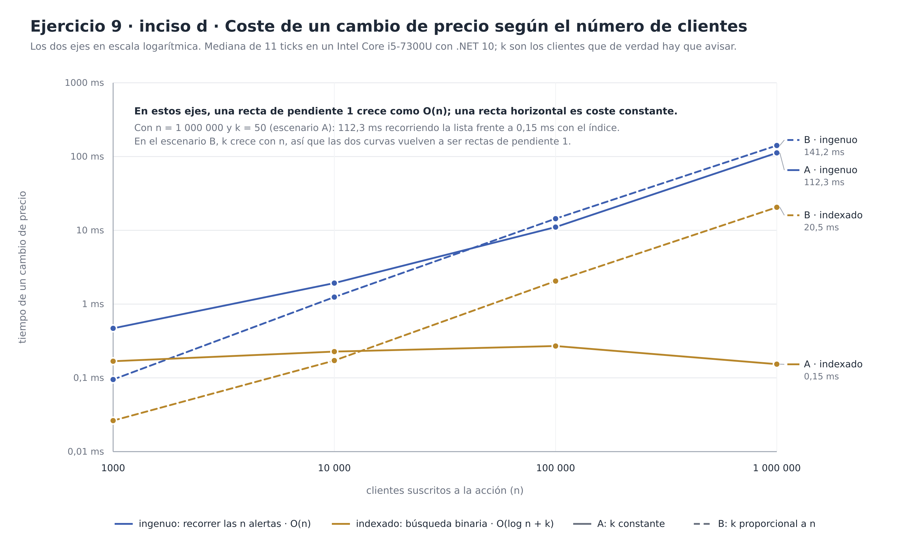

# Ejercicio 9, inciso d): Rendimiento

**Issue:** #4

> *Evalúa el rendimiento con 1M de clientes. ¿Cómo cambia el orden de complejidad? Propón Observer con Thread Pool o Reactive Streams.*

Este inciso mide el código del [inciso b](inciso-b.md) con la entrega asíncrona del [inciso c](inciso-c.md), propone una alternativa indexada y la mide junto a la versión ingenua.

```sh
cd codigo
dotnet run -c Release --project Bolsa.Notificaciones -- rendimiento          # hasta 1 000 000
dotnet run -c Release --project Bolsa.Notificaciones -- rendimiento 100000   # más rápido
dotnet test                                                                  # 27 pruebas, 7 de este inciso
```

> **Importante:** `-c Release`. En `Debug` el compilador no optimiza y los tiempos no significan nada.

## Las respuestas en corto

| Pregunta | Respuesta |
|---|---|
| ¿Cómo se comporta con 1M de clientes? | Un solo cambio de precio tarda **112,3 ms** recorriendo las alertas una por una, y ocupa **244 MB**. Con 5 acciones cotizando cada segundo, la detección sola consume más de medio segundo por segundo: el sistema no llega. |
| ¿Cómo cambia el orden de complejidad? | La versión ingenua es **Θ(n)** por cambio de precio: revisa los n umbrales aunque solo haya que avisar a k clientes. Ordenando los umbrales, los cruzados son un **tramo contiguo** que se localiza con dos búsquedas binarias: **O(log n + k)**. Medido: 112,3 ms → **0,15 ms** (731×). |
| ¿Thread Pool o Reactive Streams? | **Las dos cosas, pero en sitios distintos y por razones distintas:** un pool de consumidores para repartir los k envíos (medido: 6 409 avisos/s con 8 consumidores frente a 792 con uno), y una **cola acotada** (`System.Threading.Channels`) para el *backpressure*. Rx.NET no sirve para lo segundo, y se explica por qué. |

## Cómo se midió

- **`Stopwatch`**, no BenchmarkDotNet: la unidad que interesa no es una función aislada sino *un cambio de precio sobre una estructura de n suscripciones*, que hay que construir antes y que ocupa cientos de megabytes. BenchmarkDotNet habría dado más rigor estadístico a costa de no poder medir exactamente eso.
- **Mediana de 11 ticks**, descartando 3 de calentamiento. La mediana y no la media: una pausa del recolector de basura en un solo tick desplazaría la media.
- **Canales simulados sin E/S real** (`CanalSilencioso`, que solo cuenta). Escribir en la consola cuesta más que el envío simulado y falsearía la medición.
- **Las dos fases se miden por separado**, porque solo una cambia de orden: *detectar* a quién avisar y *entregar* los avisos.
- **Semillas y umbrales deterministas:** el benchmark es reproducible.

**Máquina:** Intel Core i5-7300U @ 2,60 GHz (2 núcleos, 4 hilos), 15 GiB de RAM, Garuda Linux x64 (kernel 7.2.11-zen), .NET SDK 10.0.113 / runtime 10.0.13, GC de estación de trabajo.

### Los dos escenarios

El resultado depende por completo de **cuántos clientes hay que avisar de verdad** en cada tick, así que se miden los dos extremos:

| Escenario | Cómo se reparten los umbrales | k por tick |
|---|---|---|
| **A · dispersos** | un umbral por centavo (densidad fija); con más clientes, la banda de precios cubierta es más ancha | **constante**: 50, no importa cuánto crezca n |
| **B · concentrados** | los n umbrales repartidos en una banda fija de 30 $ alrededor del precio | **proporcional a n**: n/100 |

Ninguno es «el realista»: el real está en medio, y por eso interesa ver los dos. A aísla el orden de complejidad de la búsqueda; B muestra qué pasa cuando el cuello de botella son los propios avisos.

## Resultados



*Versión vectorial: [`diagramas/inciso-d-escalado.svg`](diagramas/inciso-d-escalado.svg).*

### Escenario A: umbrales dispersos (k = 50 constante)

| n | k | Ingenuo Θ(n) | Indexado O(log n + k) | Mejora | Memoria ing. / idx. | Construcción ing. / idx. |
|---:|---:|---:|---:|---:|---:|---:|
| 1 000 | 50 | 0,469 ms | 0,168 ms | 2,8× | 0,2 / 0,2 MB | 2 / 1 ms |
| 10 000 | 50 | 1,925 ms | 0,227 ms | 8,5× | 2,4 / 1,8 MB | 40 / 47 ms |
| 100 000 | 50 | 11,068 ms | 0,270 ms | 41,0× | 24,4 / 17,7 MB | 577 / 169 ms |
| **1 000 000** | 50 | **112,275 ms** | **0,154 ms** | **731,4×** | 244,1 / 174,8 MB | 2 652 / 1 108 ms |

El ingenuo multiplica su tiempo por 10 cada vez que n se multiplica por 10: eso **es** Θ(n), y en la gráfica se ve como una recta de pendiente 1. El indexado se queda entre 0,15 y 0,27 ms en todo el rango: una recta horizontal. Las diferencias entre esos cuatro valores son ruido de medición, no crecimiento; lo que domina ahí no es el `log n` (20 comparaciones) sino crear los 50 mensajes.

### Escenario B: umbrales concentrados (k = n/100)

| n | k | Ingenuo Θ(n) | Indexado O(log n + k) | Mejora | Memoria ing. / idx. | Construcción ing. / idx. |
|---:|---:|---:|---:|---:|---:|---:|
| 1 000 | 10 | 0,095 ms | 0,026 ms | 3,6× | 0,2 / 0,2 MB | 1 / 1 ms |
| 10 000 | 100 | 1,245 ms | 0,172 ms | 7,3× | 2,4 / 1,7 MB | 12 / 5 ms |
| 100 000 | 1 000 | 14,383 ms | 2,054 ms | 7,0× | 24,4 / 16,8 MB | 252 / 63 ms |
| **1 000 000** | 10 000 | **141,246 ms** | **20,510 ms** | **6,9×** | 244,1 / 167,8 MB | 2 879 / 1 015 ms |

Aquí **la mejora se estanca en ~7×** y no crece con n. No es un fallo del índice: es que cuando k es proporcional a n, el término k domina y O(log n + k) *también* es Θ(n). El índice sigue ganando, pero por una constante (se ahorra tocar los 990 000 clientes que no cruzaron), no por un orden.

> **La lección del par de tablas:** el índice no «hace rápido» el sistema. Elimina el trabajo inútil —mirar umbrales que no se cruzaron— y deja solo el trabajo inevitable: atender a los k clientes que sí hay que avisar.

## ¿Cómo cambia el orden de complejidad?

### La versión ingenua: Θ(n) por cambio de precio

```csharp
public void Notificar(CambioPrecio cambio)
{
    foreach (IObservadorPrecio observador in _observadores)  // n iteraciones, siempre
    {
        observador.Actualizar(cambio);                       // 2 comparaciones de decimal
    }
}
```

Por cada cambio de precio de una acción se recorren **todos** sus observadores, se cruce su umbral o no. Si esa acción tiene n suscripciones, el costo es Θ(n), y sumando el trabajo de los k que sí cruzan, Θ(n + k) = **Θ(n)**, porque k ≤ n.

Con 1 000 000 de clientes y un tick por segundo en 5 acciones, eso es **5 000 000 de comprobaciones por segundo** para, en el escenario A, avisar a 250 personas. El 99,99 % del trabajo se tira.

### La versión indexada: O(log n + k)

La clave está en la regla de disparo del inciso b, que es un **predicado de intervalo**:

| Dirección | Notifica si | Es decir |
|---|---|---|
| `Sube` | anterior ≤ umbral **y** nuevo > umbral | umbral ∈ **[anterior, nuevo)** |
| `Baja` | anterior ≥ umbral **y** nuevo < umbral | umbral ∈ **(nuevo, anterior]** |

Si los umbrales están **ordenados**, los que cumplen esa condición no están dispersos: forman un **tramo contiguo** del array. Localizar sus dos extremos es una búsqueda binaria cada uno:

```csharp
public void Actualizar(CambioPrecio cambio)
{
    if (cambio.PrecioNuevo > cambio.PrecioAnterior)
    {
        Avisar(
            _umbralesSube,
            _clientesSube,
            PrimeroMayorOIgual(_umbralesSube, cambio.PrecioAnterior),  // O(log n)
            PrimeroMayorOIgual(_umbralesSube, cambio.PrecioNuevo),     // O(log n)
            Direccion.Sube,
            cambio);
    }
    else if (cambio.PrecioNuevo < cambio.PrecioAnterior)
    {
        // Una bajada solo puede cruzar umbrales «Baja», y al revés.
        Avisar(_umbralesBaja, _clientesBaja,
            PrimeroMayor(_umbralesBaja, cambio.PrecioNuevo),
            PrimeroMayor(_umbralesBaja, cambio.PrecioAnterior),
            Direccion.Baja, cambio);
    }
}
```

**Total: O(log n + k).** Dos búsquedas binarias más el recorrido del tramo.

### Esto no rompe el patrón: el índice es un ChangeManager

Podría parecer que indexar los umbrales obliga al sujeto a conocer a los clientes, que es justo lo que el inciso a evitaba. No es así: el índice vive **dentro de un único observador**.

```csharp
var accion = new Accion("AAPL", 150.00m);
accion.Suscribir(GestorUmbralesIndexado.Construir(suscripciones, despachador));
```

`Accion` sigue siendo el Subject, sigue teniendo una lista de `IObservadorPrecio` y **sigue sin saber nada de umbrales ni de clientes**: ahora tiene un observador en lugar de un millón. Es exactamente el `ChangeManager` que GoF propone cuando la lógica de actualización se vuelve costosa o compleja (Gamma et al., 1994, p. 333), y que el [inciso a](inciso-a.md#por-qué-no-usar-mediator) ya había mencionado como la puerta por la que un mediador puede entrar sin desplazar a Observer.

Lo que **sí** se pierde es que cada suscripción deje de ser un objeto con su propia lógica: la condición ya no la evalúa el observador, la resuelve el índice. Es el precio del cambio, y solo compensa cuando n es grande. Con 1 000 clientes la mejora es 2,8×; con 1 000 000, 731×.

### Lo que no baja de ahí: el límite inferior

**Ninguna estructura de datos puede bajar de Ω(k)**, porque hay que crear y entregar k notificaciones. O(log n + k) es óptimo en ese sentido: el término `log n` es el costo de *encontrar* a quién avisar y el término `k` es el trabajo que el problema exige. El escenario B es lo que se ve cuando se alcanza ese límite.

### Memoria

| n | Ingenuo | Indexado | Qué explica la diferencia |
|---:|---:|---:|---|
| 100 000 | 24,4 MB | 17,7 MB | — |
| 1 000 000 | 244,1 MB | 174,8 MB | ~70 MB menos (29 %) |

Las dos son **Θ(n)**: hay que guardar n suscripciones. El índice ahorra el objeto `AlertaUmbral` por suscripción y los nodos del `ImmutableList` del sujeto, y los sustituye por dos arrays planos (`decimal[]` y `Cliente[]`), que además recorren memoria contigua. Lo que domina en ambos casos son los propios clientes (identificador y contacto), que son irreducibles.

### Altas y bajas: lo que el índice empeora

Es la contrapartida honesta de la propuesta:

| Operación | Ingenuo (`ImmutableList`) | Indexado (array ordenado) |
|---|---|---|
| Suscribir | O(log n) con copia de camino | **O(n)**: hay que insertar en el array |
| Desuscribir | O(log n) | **O(n)** |
| Notificar | Θ(n) | **O(log n + k)** |
| Construir desde cero | 2 652 ms para 1M | **1 108 ms** para 1M |

Si las altas y bajas fueran tan frecuentes como los ticks, el array ordenado sería mala idea. La solución es una **estructura ordenada con inserción logarítmica** (`SortedSet`, un árbol balanceado o una *skip list*): mantiene O(log n) para suscribir y desuscribir, y el recorrido del tramo sigue siendo O(log n + k). Aquí se usa un array porque en este problema los precios cambian muchísimo más a menudo que las suscripciones, y el array da la mejor constante en el recorrido.

## El paralelismo reduce el tiempo de reloj, no el orden

Medido en el escenario B con n = 1 000 000 (k = 10 000), repartiendo el tramo encontrado con `Parallel.For`:

| | Tiempo por tick |
|---|---:|
| Indexado secuencial | 21,668 ms |
| Indexado en paralelo (4 hilos) | 12,233 ms |
| **Aceleración** | **1,77×** |

**El trabajo total no bajó: se repartió.** Con p procesadores, O(log n + k) pasa a O(log n + k/p) de tiempo de reloj, pero el *trabajo* sigue siendo O(log n + k). Como p es una constante de la máquina (aquí 4 hilos sobre 2 núcleos físicos), el orden de complejidad **no cambia**: sigue siendo lineal en k.

La aceleración de 1,77× sobre 4 hilos lógicos es lo esperable: son 2 núcleos físicos con *hyper-threading*, y parte del trabajo (reservar memoria para 10 000 notificaciones) compite por el recolector de basura, que es un recurso compartido. Es la ley de Amdahl, no un defecto de la implementación.

## ¿Thread Pool o Reactive Streams?

La pregunta tiene trampa, porque las dos cosas resuelven problemas distintos y este sistema necesita los dos.

### Lo que resuelve un pool de consumidores

Medido vaciando una cola de notificaciones ya creadas:

**(a) Canal instantáneo, 200 000 avisos** — el envío no cuesta nada:

| Consumidores | Encolar | Vaciar | Rendimiento |
|---:|---:|---:|---:|
| 1 | 60 ms | 105 ms | 1 896 mil avisos/s |
| 2 | 119 ms | 129 ms | 1 550 mil avisos/s |
| 4 | 132 ms | 138 ms | 1 454 mil avisos/s |
| 8 | 97 ms | 102 ms | 1 965 mil avisos/s |

**(b) Canal de 1 ms, 1 000 avisos** — como un proveedor real:

| Consumidores | Vaciar | Rendimiento |
|---:|---:|---:|
| 1 | 1 262 ms | 792 avisos/s |
| 2 | 577 ms | 1 734 avisos/s |
| 4 | 290 ms | 3 444 avisos/s |
| 8 | 156 ms | **6 409 avisos/s** |

Las dos tablas dicen lo mismo desde lados opuestos: **el paralelismo paga cuando cada envío espera, y estorba cuando no**. Con un canal instantáneo, añadir consumidores solo añade contención sobre la cola (1 consumidor ya da 1,9 millones de avisos/s). Con un canal de 1 ms —lo normal en un proveedor real de email o SMS— la mejora es casi lineal: 8× más consumidores dan 8,1× más rendimiento.

Y como el consumidor espera con `await` y no bloquea un hilo del sistema, subir ese número es barato. Con los ~800 avisos/s por consumidor que se midieron, atender los 10 000 avisos por tick del escenario B pediría del orden de **13 consumidores concurrentes** para despachar en un segundo.

### Lo que un pool *no* resuelve: el backpressure

Si los cambios de precio llegan más rápido de lo que se puede notificar, ningún número de hilos arregla nada: la cola crece hasta agotar la memoria. Medido con 20 000 avisos de golpe, una cola de 1 000 y un canal de 1 ms:

| | |
|---|---:|
| Encolar los 20 000 avisos | 183,1 ms (**el sujeto nunca esperó**) |
| Aceptadas y entregadas | 1 556 |
| Rechazadas por cola llena | **18 444** |
| Tiempo total hasta vaciar | 537 ms |

Perder 18 444 avisos es malo, pero **es infinitamente mejor que la alternativa silenciosa**: con una cola sin límite, esos 18 444 se habrían acumulado, el proceso habría crecido sin freno y el fallo habría llegado más tarde, peor y sin explicación. La cola acotada convierte la saturación en un número visible y en una decisión que hay que tomar.

`System.Threading.Channels` obliga a elegir esa política explícitamente:

| `BoundedChannelFullMode` | Qué hace | ¿Sirve aquí? |
|---|---|---|
| `Wait` | el productor espera | **No** para `Encolar`: volvería a bloquear al hilo del precio (inciso c). Sí para los reintentos. |
| `DropOldest` / `DropNewest` | descarta un aviso | **No**: cada aviso es un evento distinto («cruzó 152,00»), no la última foto de un estado. Descartar el más viejo pierde un cruce real. |
| `DropWrite` (rechazar) | rechaza el nuevo y lo registra | **Sí**, es lo que hace `DespachadorAsincrono`: rechaza, cuenta y registra, para que la saturación se vea. |

Y la respuesta de verdad a la saturación no es la política, sino **dimensionar**: más consumidores, particionar la cola por acción (cada acción ya es un Subject independiente) y, si aun así no se llega, degradar a propósito (agrupar en un resumen por cliente).

### Por qué Channels y no Rx.NET

El enunciado propone «Reactive Streams». Conviene distinguir dos cosas que suelen confundirse:

- **Reactive Streams** es una *especificación* (`Publisher` / `Subscriber` / `Subscription`) cuyo rasgo central es precisamente el backpressure: el suscriptor pide con `request(n)` y el productor no puede enviar más de lo pedido. La demanda va **en el protocolo**.
- **Rx.NET** (`System.Reactive`, `IObservable<T>` / `IObserver<T>`) **no implementa esa especificación**. `OnNext` es *push* puro: no hay señal de demanda y el productor no tiene forma de saber que el consumidor va retrasado. Rx ofrece operadores para sobrevivir a la avalancha (`Sample`, `Throttle`, `Buffer`), pero todos **descartan o agrupan**; ninguno frena al productor.

Para este problema eso es decisivo, porque lo que hace falta es justo frenar o rechazar de forma controlada. Por eso la propuesta es:

| Pieza | Elección | Por qué |
|---|---|---|
| Detección | índice ordenado dentro de un ChangeManager | O(log n + k) en vez de Θ(n) |
| Reparto de los k avisos | thread pool (`Parallel.For`) sobre el tramo | 1,77× medido; ayuda cuando k es grande |
| Transporte | **`Channel<T>` acotado** del BCL | tiene el backpressure que a `IObservable<T>` le falta, sin dependencias nuevas |
| Envío | consumidores `async` dimensionados por la latencia del proveedor | 6 409 avisos/s con 8 consumidores; escalan sin gastar hilos |

`System.Threading.Channels` viene en la biblioteca base, no añade ningún paquete y ya expone `WriteAsync` (demanda) y `BoundedChannelFullMode` (política). Si en el futuro hiciera falta componer flujos (combinar acciones, ventanas temporales, *conflation* de avisos), Rx.NET sería un buen complemento **encima** de la cola, no en su lugar.

## Propuesta final

Ordenada por lo que aporta frente a lo que cuesta:

1. **Indexar los umbrales por acción** dentro de un ChangeManager: de Θ(n) a O(log n + k). Es el único cambio que modifica el orden de complejidad, y es el que vale 731× con 1M de clientes.
2. **Mantener el índice en una estructura ordenada con inserción logarítmica** si las suscripciones cambian a menudo, en vez del array del prototipo.
3. **Particionar por acción**, que el diseño del inciso a ya permite: cada `Accion` es un Subject independiente con su propio índice y su propia cola.
4. **Cola acotada + consumidores `async`**, dimensionados con la latencia real del proveedor y con la política de saturación explícita y medida.
5. **Observar el sistema**: `Entregadas`, `Rechazadas`, `Reintentos`, `FallosDefinitivos` y el tamaño de la cola ya están expuestos como contadores.

## Pruebas unitarias

Una optimización que cambia el comportamiento no es una optimización. `dotnet test` ejecuta **27 pruebas, todas correctas**; 7 son de este inciso:

| Prueba | Qué comprueba |
|---|---|
| `NotificaExactamenteALosMismosClientesQueLasAlertasIndividuales` | **La prueba central.** 500 suscripciones con umbrales y direcciones aleatorias (semilla fija) y 40 cambios de precio: el índice y las alertas una por una producen exactamente el mismo conjunto de notificaciones, mismo cliente y mismo mensaje |
| `ElIndiceEnParaleloNotificaLoMismoQueElSecuencial` | `Parallel.For` no cambia el resultado, solo el reparto |
| `NotificaSoloALosDelTramoCruzadoAlAlza` | Quedan fuera los ya cruzados, los que están por encima del precio nuevo y los de dirección contraria |
| `NotificaSoloALosDelTramoCruzadoALaBaja` | Lo mismo en el otro sentido |
| `RespetaLosExtremosDelTramo` | Umbral igual al precio anterior sí notifica; igual al precio nuevo, no. Es donde una búsqueda binaria se equivoca por uno |
| `NoNotificaCuandoNingunUmbralQuedaEnElTramo` | Movimientos que no cruzan nada no generan avisos |
| `ElSujetoSoloVeUnObservador` | El índice es un `IObservadorPrecio`: la acción sigue sin conocer a los clientes |

## Ficheros de este inciso

| Fichero | Qué es |
|---|---|
| `Rendimiento/GestorUmbralesIndexado.cs` | El ChangeManager con el índice ordenado y las búsquedas binarias |
| `Rendimiento/SuscripcionUmbral.cs` | La suscripción como dato (cliente, umbral, dirección) |
| `Rendimiento/DespachadorContador.cs`, `RepositorioContador.cs` | Dobles que solo cuentan, para medir la detección sin el costo de la entrega |
| `Demos/BenchmarkRendimiento.cs` | El benchmark completo |
| `Observer/AlertaUmbral.cs` | **Modificado:** el texto del aviso se extrae a `Mensaje(...)` para que el índice genere exactamente el mismo mensaje |

## Referencias

Gamma, E., Helm, R., Johnson, R., y Vlissides, J. (1994). *Design patterns: Elements of reusable object-oriented software*. Addison-Wesley.

> El `ChangeManager` está en la p. 333 de la copia del libro en la bibliografía de la asignatura (`Documentacion Patrones`), dentro de la sección *Implementation* del patrón Observer.
