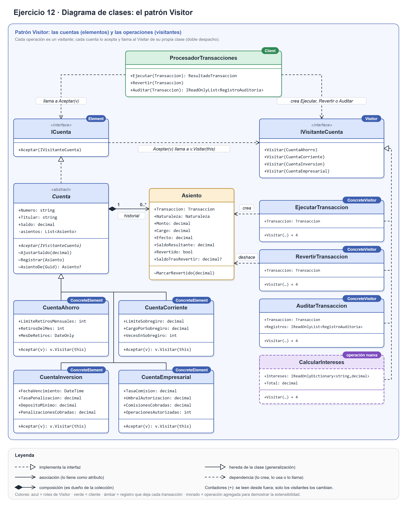
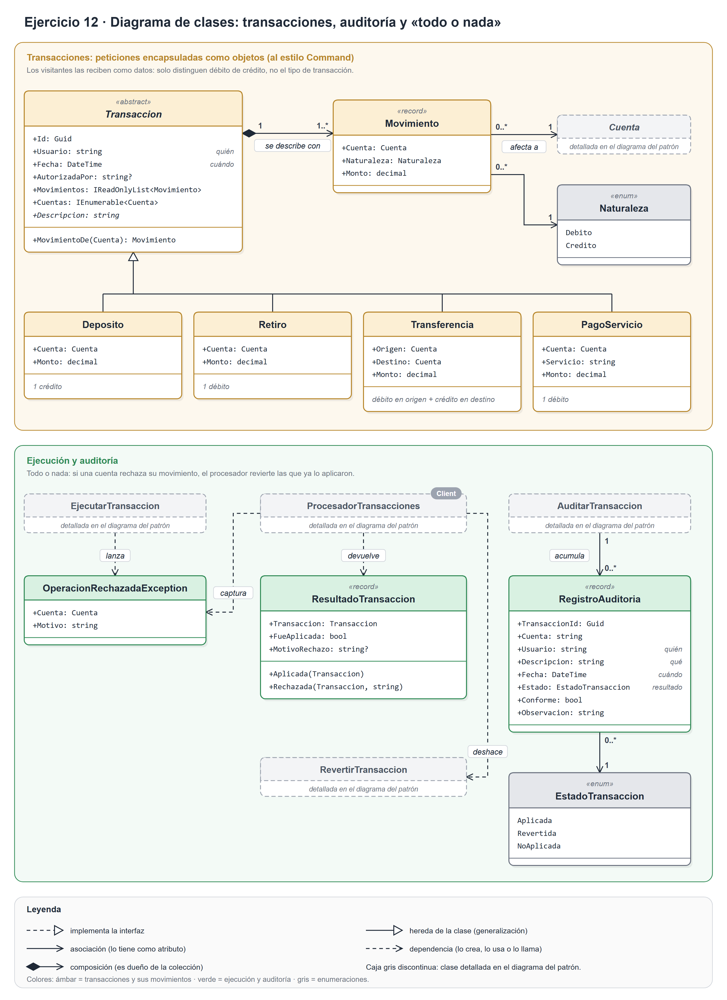

# Ejercicio 12, inciso a): Identificación del patrón

**Issue:** #6

> *Identifica el patrón de diseño más adecuado, justifica tu selección basándote en las características del problema y explica la propuesta de solución considerando las clases que intervienen y las relaciones entre ellas. ¿Por qué no usar Strategy o polimorfismo simple?*

## Patrón seleccionado: Visitor

Visitor representa una operación que se aplica a los elementos de una estructura de objetos, y permite definir operaciones nuevas sin cambiar las clases de los elementos sobre los que opera (Gamma et al., 1994, p. 366). La conferencia de la asignatura lo presenta como una forma de separar un algoritmo de la estructura de objetos sobre la que opera, siguiendo el principio abierto/cerrado (*Marcos de Trabajo y Patrones de Diseño*, diap. 40).

En este problema, los **elementos** son las cuentas, y las **operaciones** son visitantes: ejecutar, revertir y auditar, y las que vengan después, como «congelar cuenta» o «calcular intereses».

> El enunciado nombra tres tipos de cuenta (ahorro, corriente e inversión). El inciso b pide cuatro y agrega la cuenta empresarial, así que el diseño usa las cuatro.

## Justificación

GoF recomienda Visitor en tres situaciones (Gamma et al., 1994, p. 368), y las tres se dan en este problema (las tres primeras filas de la tabla). Además, dos consecuencias del patrón resuelven otros dos requisitos del enunciado (las dos últimas filas):

| Característica del problema | Cómo la resuelve Visitor |
|---|---|
| **El comportamiento depende de dos cosas a la vez**: de la operación y del tipo de cuenta. Un retiro no se ejecuta igual en una cuenta de ahorro (límite de retiros al mes), en una corriente (sobregiro) o en una de inversión (penalización por retiro anticipado). | **Doble despacho**: `cuenta.Aceptar(visitante)` elige el código según la operación y según la cuenta, sin `if` ni `switch` por tipo (ver más abajo). GoF lo recomienda cuando las operaciones dependen de la clase concreta de cada objeto (p. 368). |
| **Las operaciones no tienen relación entre sí.** Mover dinero, deshacerlo, auditar y calcular intereses son responsabilidades distintas. | Cada operación queda reunida en su propia clase y no se reparte por las cuentas (GoF, pp. 368, 371). Por ejemplo, toda la auditoría vive en `AuditarTransaccion`. |
| **Los tipos de cuenta son estables y las operaciones crecen.** Un banco crea productos nuevos muy de vez en cuando; en cambio, el enunciado ya anticipa operaciones nuevas. | Es el caso para el que GoF recomienda Visitor: las clases de la estructura rara vez cambian, pero a menudo se quieren operaciones nuevas (pp. 368, 371). |
| **Hay que poder añadir operaciones** («congelar cuenta», «calcular intereses») **sin modificar las cuentas ni las transacciones**. | Una operación nueva es **una clase visitante nueva**, y ninguna cuenta cambia. Según GoF, Visitor hace fácil añadir operaciones (p. 370). Es el principio abierto/cerrado aplicado a las operaciones. |
| **La auditoría acumula resultados** mientras recorre las cuentas: un registro por cuenta, y totales por sucursal en el inciso c. | Un visitante puede acumular estado mientras visita los elementos (GoF, p. 372). |

## Propuesta de solución: clases y relaciones

El diseño se presenta en dos figuras. La primera muestra el patrón; la segunda, las transacciones y la auditoría. Hay una guía para leerlas en [`diagramas/como-leer-los-diagramas.md`](diagramas/como-leer-los-diagramas.md).





*Versiones vectoriales y editables: [`inciso-a-visitor.svg`](diagramas/inciso-a-visitor.svg) e [`inciso-a-transacciones.svg`](diagramas/inciso-a-transacciones.svg).*

### Roles del patrón (figura 1)

| Rol (GoF) | Clase | Qué hace |
|---|---|---|
| Element | `ICuenta` | Declara `Aceptar(IVisitanteCuenta)` y nada más. El inciso c solo necesita esta interfaz para que un grupo de cuentas (Composite) se trate igual que una cuenta. |
| ConcreteElement | `CuentaAhorro`, `CuentaCorriente`, `CuentaInversion`, `CuentaEmpresarial` | Implementan `Aceptar` con una sola línea, `visitante.Visitar(this)`, y guardan los parámetros y contadores de su tipo. Heredan de la clase abstracta `Cuenta`, que tiene lo común: número, titular, saldo e historial de asientos. |
| Visitor | `IVisitanteCuenta` | Declara un `Visitar` por cada clase de cuenta (cuatro sobrecargas). |
| ConcreteVisitor | `EjecutarTransaccion`, `RevertirTransaccion`, `AuditarTransaccion` | Las tres operaciones del enunciado. Cada `Visitar` aplica la regla de esa operación para ese tipo de cuenta. `CalcularIntereses` es una cuarta operación, agregada en el inciso b para demostrar la extensibilidad. |
| ObjectStructure | las cuentas de una transacción | GoF admite que sea una colección o un Composite (p. 370). Aquí son las cuentas a las que afectan los movimientos de la transacción; en el inciso c será un grupo de cuentas. |
| Client | `ProcesadorTransacciones` | Crea el visitante de la operación (`EjecutarTransaccion`, `RevertirTransaccion` o `AuditarTransaccion`) y llama a `Aceptar` en cada cuenta de la transacción. Para pasar el visitante solo usa `ICuenta`: no sabe qué tipos de cuenta hay ni cuáles son sus reglas. |

**Relaciones y multiplicidades.** Las cuatro cuentas heredan de `Cuenta`, que implementa `ICuenta`. Los visitantes implementan `IVisitanteCuenta`. Cada `Cuenta` es dueña de 0 a muchos `Asiento` (composición). Cada visitante de transacción guarda la `Transaccion` que procesa (su atributo `Transaccion`). En la figura 2, cada `Transaccion` se describe con 1 o más `Movimiento`, y cada movimiento afecta a 1 `Cuenta`.

### El doble despacho, sin `if` ni `switch`

```csharp
// En cada cuenta concreta (aquí, la corriente):
public override void Aceptar(IVisitanteCuenta visitante) => visitante.Visitar(this);

// En el cliente, que pasa el visitante a través de ICuenta:
cuenta.Aceptar(new EjecutarTransaccion(retiro));
```

1. **Primer despacho.** `cuenta.Aceptar(...)` es una llamada virtual: se ejecuta el `Aceptar` de la clase real de la cuenta, por ejemplo `CuentaCorriente`.
2. **Segundo despacho.** Dentro de ese `Aceptar`, `this` es de tipo `CuentaCorriente`, así que el compilador elige la sobrecarga `Visitar(CuentaCorriente)`. Como `visitante.Visitar` también es una llamada virtual, se ejecuta la de la operación real, `EjecutarTransaccion`.

El código que se ejecuta depende de dos tipos, el de la operación y el de la cuenta: es lo que GoF llama doble despacho (p. 374). En ningún momento se pregunta de qué tipo es la cuenta. Además, si se agrega un tipo de cuenta, el programa no compila hasta que todos los visitantes tienen su `Visitar`.

### ¿Dónde están las transacciones?

Las transacciones (depósito, retiro, transferencia y pago de servicios) son **objetos que encapsulan una petición**, al estilo del patrón Command. GoF menciona que Command también se conoce como *Transaction* (p. 263) y que es una forma de modelar transacciones, entendidas como un conjunto de cambios sobre los datos (p. 266). La conferencia lo describe como encapsular una petición para poder encolarla, llevar un registro y deshacerla (diap. 34). Son justo las tres cosas que pide el enunciado: ejecutar, auditar y revertir.

En la figura 2:

- **`Transaccion`** (abstracta) guarda **quién** la pidió (`Usuario`), **cuándo** (`Fecha`), la autorización si hace falta y sus **movimientos**. Las cuatro transacciones del enunciado son subclases.
- Cada transacción se describe con **débitos y créditos** (`Movimiento`). Un depósito es un crédito; un retiro o un pago, un débito; una transferencia, un débito en el origen y un crédito en el destino.
- Cada movimiento apunta a una `Cuenta`, la clase base de las cuentas reales, y no a `ICuenta`: un depósito o un retiro afecta siempre a una cuenta concreta, nunca a un grupo de cuentas del inciso c. Un grupo se puede visitar, pero no puede ser el destino de un movimiento.
- Los visitantes **reciben la transacción como datos** en su constructor (`new EjecutarTransaccion(transaccion)`), y en cada cuenta aplican el movimiento que le corresponde.

**Por qué no un Command completo**, con `Ejecutar()` y `Deshacer()` dentro de cada transacción:

1. **Una operación nueva obligaría a modificar todas las transacciones.** «Auditar» o «calcular intereses» serían métodos nuevos en las cuatro clases de transacción, y el enunciado prohíbe modificarlas.
2. **Dentro de cada `Ejecutar()` habría que preguntar por el tipo de cuenta**, porque un retiro no se aplica igual en una cuenta de ahorro que en una corriente. Volverían los `if` y `switch` por tipo.

Con este reparto, los visitantes solo distinguen **débito de crédito**, no el tipo de transacción. Por eso un tipo de transacción nuevo, por ejemplo un pago de nómina (un débito y varios créditos), es solo otra subclase que describe sus movimientos: no cambia ningún visitante ni ninguna cuenta.

### ¿Qué se guarda para poder revertir?

Cuando `EjecutarTransaccion` aplica un movimiento, deja en la cuenta un **`Asiento`** con la transacción, si fue débito o crédito, el monto y el **cargo** que cobró la regla de la cuenta (comisión, penalización o cargo por sobregiro). Es decir, se guarda **el efecto exacto que se aplicó**, no una foto del estado anterior. El asiento también anota el saldo en que la transacción dejó la cuenta, para que la auditoría la juzgue por lo que hizo.

`RevertirTransaccion` busca ese asiento y aplica la **operación inversa**: resta del saldo el efecto que tuvo (en un débito devuelve el monto y el cargo; en un crédito retira el monto). Después descuenta los contadores propios de cada tipo de cuenta: el retiro del mes en la de ahorro, el sobregiro en la corriente, la penalización en la de inversión, y la comisión y la autorización en la empresarial. Por último, marca el asiento como revertido para que no se deshaga dos veces.

**Se descartó Memento**, que guarda una foto del estado para restaurarla después (Gamma et al., 1994, p. 316; conferencia, diap. 38). Restaurar una foto **borra las transacciones que se aplicaron después** sobre la misma cuenta. Eso pasa siempre que se revierte una transacción que no es la última, y con operaciones en paralelo (la restricción del enunciado) es lo habitual. Por ejemplo:

| Paso | Saldo |
|---|---|
| Saldo inicial | 1000 |
| Retiro de 100 | 900 |
| Depósito de 50 | 950 |
| Revertir el retiro restaurando la foto anterior | 1000: **se pierde el depósito** |
| Revertir el retiro aplicando la operación inversa | **1050**, correcto |

GoF admite que un comando que se puede deshacer guarde los argumentos de la operación que aplicó (p. 269), y eso es lo que guarda el `Asiento`. También describe mementos que guardan solo el cambio incremental (p. 321), pero exigen deshacer en un orden predecible, y aquí no se cumple: se puede revertir cualquier transacción, no solo la última. La conferencia de Arquitecturas llama a esta técnica **compensación de transacciones** (diap. 58).

### Decisiones de diseño

> **Las reglas de negocio viven en los visitantes, no en las cuentas.** Las cuentas solo guardan sus datos y parámetros: límite de retiros, tope de sobregiro, tasas y umbral de autorización. Así cada operación nueva trae sus propias reglas sin tocar las cuentas.
>
> **Todo o nada.** Una transferencia afecta a dos cuentas. Si el débito ya se aplicó y el crédito se rechaza (por ejemplo, el destino es una cuenta de inversión y el monto no llega al depósito mínimo), `ProcesadorTransacciones` deshace el débito con el mismo `RevertirTransaccion`. Es la base de la atomicidad que pide la restricción.
>
> **Revertir es una compensación obligatoria.** No aplica las reglas de la cuenta: si se revierte un depósito que ya se gastó, el saldo puede quedar por debajo de lo que permite la cuenta, y `AuditarTransaccion` lo marca como no conforme. En un banco, una reversión (por ejemplo, la de un cheque sin fondos) no se puede rechazar por falta de saldo.
>
> **La auditoría juzga la transacción, no el estado actual de la cuenta.** Revisa lo que dice el asiento: el cargo cobrado, la autorización y el saldo en que la transacción (o su reversión) dejó la cuenta. Así, una transacción correcta sigue siendo conforme aunque después otras cambien la cuenta.

## ¿Por qué no usar Strategy?

Strategy define una familia de algoritmos intercambiables para **un mismo contexto** (Gamma et al., 1994, p. 349; conferencia, diap. 39). El despacho es simple: el código que se ejecuta depende solo de la estrategia elegida. En este problema depende de dos cosas a la vez, y con Strategy una de las dos queda sin resolver:

- **Si cada operación fuera una estrategia** (`IOperacion.Aplicar(Cuenta)`), dentro de cada una habría que preguntar qué tipo de cuenta llegó:

  ```csharp
  if (cuenta is CuentaAhorro ahorro) { /* límite de retiros */ }
  else if (cuenta is CuentaCorriente corriente) { /* sobregiro */ }
  // … y así con cada tipo de cuenta, en cada operación
  ```

  Son justo los condicionales que Strategy debería eliminar (GoF, p. 352), y el antipatrón *Spaghetti Code* («muchos if o switch») de la conferencia (diap. 45). Además, si se agrega un tipo de cuenta, el compilador no avisa en qué estrategias falta su caso: el caso nuevo se ignora en silencio o falla en ejecución. Con Visitor, el programa no compila hasta que cada visitante tiene su `Visitar`.
- **Si cada cuenta tuviera su estrategia** (las reglas de ahorro, las de corriente…), cada operación nueva sería un método nuevo en la interfaz de la estrategia y en todas sus implementaciones. Es el mismo problema que el del polimorfismo simple (siguiente sección).
- **En Strategy, el cliente elige el algoritmo**, y por eso tiene que conocer las estrategias (GoF, p. 353). Aquí nadie elige: la regla la impone el tipo de cuenta.

Strategy sí sería adecuado para una variación de una sola dimensión, por ejemplo cambiar la fórmula de interés de un mismo tipo de cuenta.

## ¿Por qué no usar polimorfismo simple?

Polimorfismo simple sería declarar un método virtual por operación en `Cuenta` (`Ejecutar`, `Revertir` y `Auditar`) y redefinirlo en cada cuenta.

- **Cada operación nueva obligaría a modificar las cuatro clases de cuenta**, además de la clase base: «calcular intereses» tocaría 5 clases y «congelar cuenta», otras 5. Es lo que el enunciado prohíbe («sin modificar las clases de las cuentas»). Con Visitor, cada operación es 1 clase nueva y 0 cuentas modificadas. El inciso d compara las dos opciones en detalle.
- **Las cuentas acumularían responsabilidades sin relación entre sí**: mover dinero, deshacerlo, auditar, calcular intereses… La clase de cada cuenta crecería con cada operación hasta convertirse en el antipatrón *The Blob* (clases gigantes) de la conferencia (diap. 45). GoF lo describe como «contaminar» las clases con operaciones (p. 368).

El polimorfismo simple solo conviene en el caso contrario: cuando los tipos de cuenta cambian a menudo y las operaciones son fijas (GoF, p. 371). No es lo que plantea el enunciado.

## Desventajas de Visitor y cómo se acotan

- **Agregar un tipo de cuenta es caro.** Hay que agregar un `Visitar` a `IVisitanteCuenta` e implementarlo en todos los visitantes (GoF, p. 371): aquí, en los 3 del enunciado y en `CalcularIntereses`. Se acepta porque los tipos de cuenta son estables; el inciso d lo cuantifica.
- **Debilita la encapsulación.** Los visitantes tienen que cambiar el saldo y los contadores de la cuenta, así que la cuenta debe exponerlos (GoF, p. 372). Se acota con `internal`: los contadores tienen lectura pública, pero solo se pueden cambiar desde el ensamblado del banco, y fuera de él las cuentas solo se pueden leer.
- **Cada visitante tiene que implementar los cuatro `Visitar`**, aunque en una operación dos cuentas se traten igual. Se resuelve con métodos privados comunes dentro del visitante (por ejemplo, `Aplicar` en `EjecutarTransaccion`), sin copiar código.
- **Las sobrecargas de `Visitar` hacen menos evidente qué método se llama**, porque todas tienen el mismo nombre y solo cambia el tipo del parámetro. GoF lo presenta como una cuestión de preferencia (p. 380, nota 10); aquí se usan sobrecargas porque es lo habitual en C#.

## Patrones relacionados

| Patrón | Relación con esta solución |
|---|---|
| Command | Las transacciones son peticiones encapsuladas como objetos (ver arriba). |
| Memento | Se descartó para revertir: restaurar una foto del estado borraría transacciones posteriores. |
| Composite | En el inciso c, un grupo de cuentas implementa `ICuenta` y su `Aceptar` pasa el visitante a sus hijos. GoF lo señala como un uso típico de Visitor (p. 380). |
| Iterator | En el inciso c, recorre las transacciones de una cuenta sin exponer su lista interna. |

## Usos conocidos

- **.NET:** `System.Linq.Expressions.ExpressionVisitor` recorre árboles de expresiones con un método `Visit…` por cada tipo de nodo. Los proveedores de LINQ lo usan; por ejemplo, Entity Framework lo usa para traducir consultas a SQL.
- **La API de Roslyn (el compilador de C#):** `CSharpSyntaxVisitor` tiene un `Visit…` por cada tipo de nodo del árbol de sintaxis. Es el mismo ejemplo con el que GoF presenta el patrón: un compilador que aplica muchas operaciones a un árbol de sintaxis (p. 366).

## Referencias

Gamma, E., Helm, R., Johnson, R., y Vlissides, J. (1994). *Design patterns: Elements of reusable object-oriented software*. Addison-Wesley.

Ingeniería de Software. *Marcos de Trabajo y Patrones de Diseño* [diapositivas de la conferencia].

Ingeniería de Software. *Arquitecturas de Software* [diapositivas de la conferencia].

> Los números de página del libro corresponden a la copia de la bibliografía de la asignatura (`Documentacion Patrones`), igual que en el ejercicio 9.
